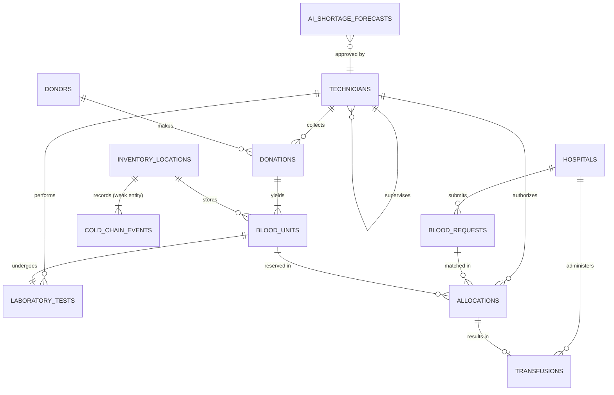
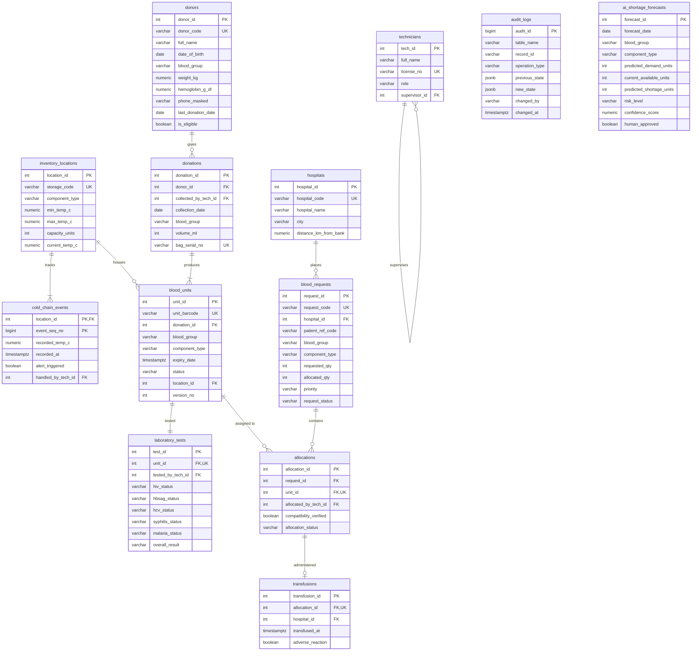

# Phase 4 & 5: Conceptual & Physical ER Models and Normalization Worksheets (UNF to BCNF)
**Course:** DBMS CSL0311 – Problem-Based & Project-Based Learning  
**Project:** AI-Assisted Blood Bank and Donor Matching System (ITM University Gwalior)  
**Authors:** Diya Motwani, Gaurav Agrawal, Ayan Khan, Ch. Mohith  

---

## 1. Conceptual Entity-Relationship Model (Mermaid)



---

## 2. Physical Relational Schema Model (Mermaid)



---

## 3. Structural Relationship Justifications
1. **Recursive Relationship (`technicians`):**  
   `technicians.supervisor_id` references `technicians.tech_id`. This allows hierarchical organizational modeling where senior technologists supervise duty phlebotomists and sign off on laboratory exceptions.
2. **Weak Entity (`cold_chain_events`):**  
   A cold-chain reading has no clinical meaning without its parent refrigerator. It uses a composite primary key `(location_id, event_seq_no)` where `location_id` acts as both part of the primary key and the foreign key to `inventory_locations`.
3. **Associative Entity (`allocations`):**  
   Resolves the Many-to-Many (M:N) relationship between `blood_requests` (which may require several units) and `blood_units` (which can fulfill different hospital requisitions over time). A UNIQUE constraint on `unit_id` ensures a blood unit is assigned to at most one active requisition.

---

## 4. Normalization Worksheets: Step-by-Step Proof (UNF -> BCNF)

### 4.1 Unnormalized Form (UNF)
Consider a traditional flat hospital blood transfusion log sheet:
```text
TRANSFUSION_LOG(
    DonorID, DonorName, DonorDOB, DonorPhone, DonorCity,
    DonationID, DonationDate, BagSerial, Volume,
    UnitBarcode, ComponentType, ExpiryDate, UnitStatus, StorageCode, RefrigTemp,
    TestID, HIV, HBsAg, HCV, VDRL, Malaria, OverallTestResult,
    HospitalID, HospitalName, HospitalCity,
    RequestID, RequestCode, PatientMRN, PatientAge, ClinicalDiagnosis,
    AllocID, AllocDate, TechID, TechName, TechRole, SupervisorName,
    TransfusionDate, AdverseReaction, ReactionNotes
)
```
- **Anomalies in UNF:**
  - *Insertion Anomaly:* Cannot record a new donor before they have completed a donation. Cannot register a storage freezer before units are placed inside.
  - *Deletion Anomaly:* Deleting an expired blood unit deletes historical donor details and testing history.
  - *Update Anomaly:* If a hospital changes contact number, hundreds of historical request rows must be individually updated.

---

### 4.2 First Normal Form (1NF)
**Definition:** A relation is in 1NF if all column values are atomic and there are no repeating groups.
- In UNF, multiple tests or multiple blood components derived from one donation were grouped in multivalued fields.
- **Action:** Split into distinct relations with single atomic attributes and explicit primary keys.
  - `R_DONOR(donor_id, donor_code, full_name, dob, gender, blood_group, weight, hb, phone, city)`
  - `R_DONATION(donation_id, donor_id, tech_id, collection_date, bag_serial_no, volume)`
  - `R_UNIT(unit_id, unit_barcode, donation_id, blood_group, component_type, expiry_date, status, location_id)`
  - `R_TEST(test_id, unit_id, tech_id, hiv, hbsag, hcv, syphilis, malaria, overall_result)`
  - `R_HOSPITAL(hospital_id, hospital_code, hospital_name, city, distance_km)`
  - `R_REQUEST(request_id, request_code, hospital_id, patient_ref, blood_group, component, requested_qty, allocated_qty, priority)`
  - `R_ALLOCATION(allocation_id, request_id, unit_id, tech_id, allocated_at, status)`
  - `R_TRANSFUSION(transfusion_id, allocation_id, hospital_id, transfused_at, adverse_reaction)`

---

### 4.3 Second Normal Form (2NF)
**Definition:** A relation is in 2NF if it is in 1NF and every non-prime attribute is fully functionally dependent on the entire primary key (no partial key dependencies).
- **Analysis:**
  - In `cold_chain_events`, the composite PK is `(location_id, event_seq_no)`.
  - Non-prime attributes: `recorded_temp_c`, `recorded_at`, `alert_triggered`.
  - Functional Dependency: `(location_id, event_seq_no) -> recorded_temp_c, recorded_at`.
  - Neither `location_id` alone nor `event_seq_no` alone determines the temperature reading. Hence, **no partial dependency exists**.
  - All other relations possess single-attribute surrogate primary keys (`donor_id`, `unit_id`, etc.), which mathematically precludes partial key dependencies.
- **Conclusion:** All relations satisfy 2NF.

---

### 4.4 Third Normal Form (3NF)
**Definition:** A relation is in 3NF if it is in 2NF and no non-prime attribute is transitively dependent on the primary key ($X \to Y$ and $Y \to Z$ where neither $X$ nor $Y$ is a superkey).
- **Potential Transitive Risk in Initial Draft:**
  - In `blood_units`, suppose we had included `(unit_id, location_id, storage_code, facility_zone, min_temp_c, max_temp_c)`.
  - Functional Dependencies:
    - $FD_1: \text{unit\_id} \to \text{location\_id}$
    - $FD_2: \text{location\_id} \to \text{storage\_code, min\_temp\_c, max\_temp\_c}$
  - Here, $\text{unit\_id} \to \text{min\_temp\_c}$ is a **transitive dependency** through `location_id`.
- **Resolution:**
  - Decompose into:
    - `inventory_locations(location_id, storage_code, facility_zone, min_temp_c, max_temp_c, capacity_units)`
    - `blood_units(unit_id, unit_barcode, ..., location_id)`
- **Check for All Relations:**
  - In `donors`: Primary key is `donor_id`. Candidate key is `donor_code`. All non-key attributes (`full_name`, `dob`, `blood_group`, `weight_kg`, `hemoglobin_g_dl`) depend directly on `donor_id`. No non-prime attribute determines another non-prime attribute.
  - In `blood_requests`: Primary key is `request_id`. Hospital details (`hospital_name`, `city`) are stored in `hospitals`, referenced only via `hospital_id`.
- **Conclusion:** All 14 relations satisfy 3NF.

---

### 4.5 Boyce-Codd Normal Form (BCNF)
**Definition:** A relation $R$ is in BCNF if for every non-trivial functional dependency $X \to Y$, $X$ is a **superkey** of $R$.

Let us examine every functional dependency across the key relations:

1. **`donors`:**
   - Candidate Keys: $CK_1 = \{\text{donor\_id}\}$, $CK_2 = \{\text{donor\_code}\}$
   - Dependencies:
     - $\text{donor\_id} \to \text{donor\_code, full\_name, dob, gender, blood\_group, weight\_kg, hemoglobin\_g\_dl, ...}$
     - $\text{donor\_code} \to \text{donor\_id, full\_name, dob, gender, ...}$
   - Since both determinants ($\text{donor\_id}$ and $\text{donor\_code}$) are superkeys, BCNF is strictly satisfied.

2. **`blood_units`:**
   - Candidate Keys: $CK_1 = \{\text{unit\_id}\}$, $CK_2 = \{\text{unit\_barcode}\}$
   - Dependencies:
     - $\text{unit\_id} \to \text{unit\_barcode, donation\_id, blood\_group, component\_type, expiry\_date, status, location\_id}$
     - $\text{unit\_barcode} \to \text{unit\_id, donation\_id, ...}$
   - Both determinants are superkeys. BCNF is strictly satisfied.

3. **`laboratory_tests`:**
   - Candidate Keys: $CK_1 = \{\text{test\_id}\}$, $CK_2 = \{\text{unit\_id}\}$ (1:1 relationship with unit)
   - Dependencies:
     - $\text{test\_id} \to \text{unit\_id, tested\_by\_tech\_id, hiv\_status, ..., overall\_result}$
     - $\text{unit\_id} \to \text{test\_id, tested\_by\_tech\_id, hiv\_status, ..., overall\_result}$
   - Both determinants are superkeys. BCNF is strictly satisfied.

4. **`allocations`:**
   - Candidate Keys: $CK_1 = \{\text{allocation\_id}\}$, $CK_2 = \{\text{unit\_id}\}$ (for active allocations)
   - Dependencies:
     - $\text{allocation\_id} \to \text{request\_id, unit\_id, allocated\_by\_tech\_id, allocated\_at, allocation\_status}$
     - $\text{unit\_id} \to \text{allocation\_id, request\_id, ...}$
   - Both determinants are superkeys. BCNF is strictly satisfied.

5. **`cold_chain_events`:**
   - Candidate Key: $CK = \{(\text{location\_id}, \text{event\_seq\_no})\}$
   - Dependencies:
     - $(\text{location\_id}, \text{event\_seq\_no}) \to \text{recorded\_temp\_c, recorded\_at, alert\_triggered, handled\_by\_tech\_id}$
   - Determinant is the composite primary key. BCNF is strictly satisfied.

### Summary Verification
Every relation $R \in \{\text{schema\_versions}, \text{technicians}, \text{inventory\_locations}, \text{donors}, \text{donations}, \text{blood\_units}, \text{laboratory\_tests}, \text{cold\_chain\_events}, \text{hospitals}, \text{blood\_requests}, \text{allocations}, \text{transfusions}, \text{audit\_logs}, \text{ai\_shortage\_forecasts}\}$ is in **Boyce-Codd Normal Form (BCNF)**. Redundancy is minimized, and anomaly-free operational behavior is mathematically guaranteed.

